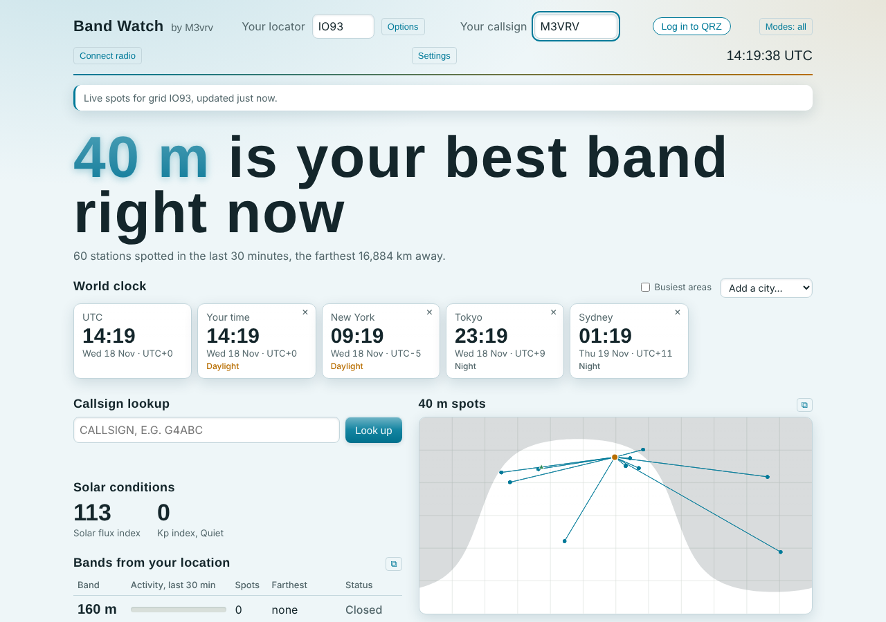
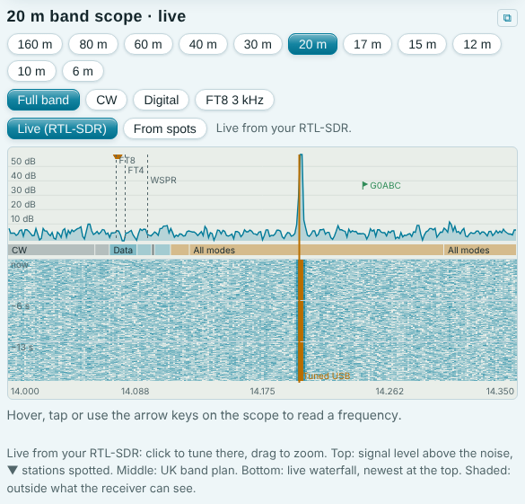
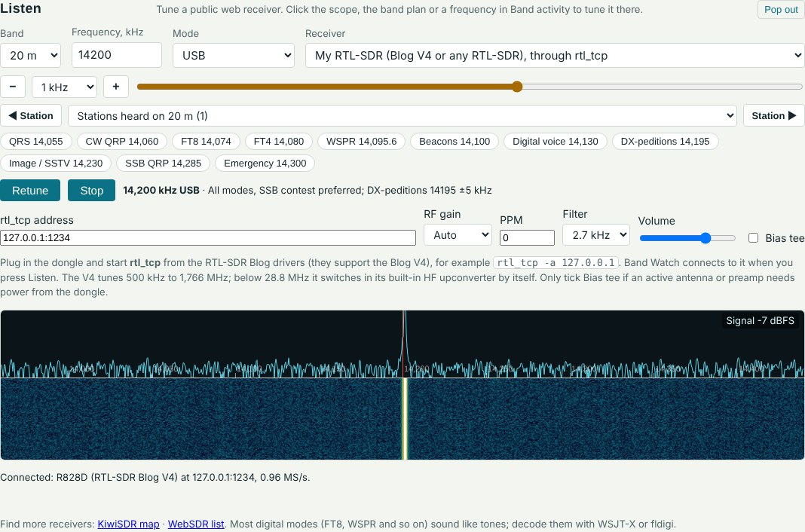
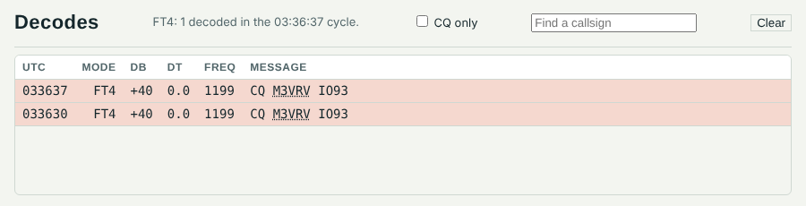
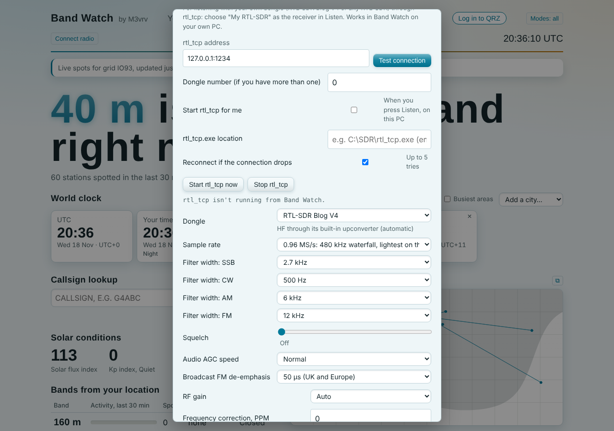
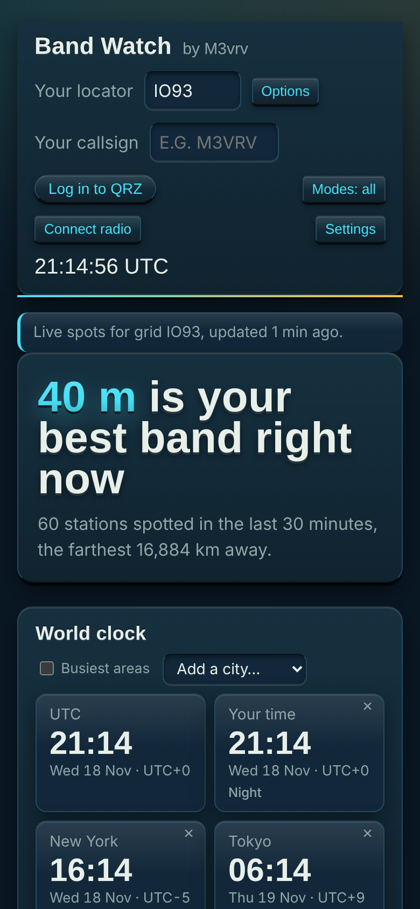

# Band Watch by M3vrv

Live HF band conditions for radio amateurs: which bands are open from where you are, from
PSK Reporter spots and NOAA solar data. Free to use, free to share (MIT licence).

- **On a phone, tablet or any browser:** open <https://band-watch.ample.run>
- **On a Windows PC:** download **BandWatch-Setup.exe** from the
  [latest release](https://github.com/TecSpyPie/band-watch/releases/latest), run it, answer Yes. It installs to `C:\BandWatch`
  for you only (no administrator rights) and adds desktop and Start menu shortcuts.

## What it does

- Best band now, a bands table and a map of who hears whom, from live PSK Reporter spots
- Band scope: live spectrum and waterfall from your RTL-SDR, or drawn from spots
- Listen: public WebSDR/KiwiSDR receivers, or your own RTL-SDR (Blog V4, V3 or others) through rtl_tcp
- FT8 and FT4 decoders with a results window
- UK band plan, sunspots and space weather, world clock, band monitor alerts
- QRZ.com lookups (sign in with your own QRZ account; your password goes only to QRZ.com and is never stored)

## Screenshots

| Live band scope from your RTL-SDR | Listen with your RTL-SDR |
|---|---|
|  |  |

| FT8 / FT4 decoder | Decodes window |
|---|---|
|  |  |

| RTL-SDR settings | On a phone (dark mode) |
|---|---|
|  |  |

*Screenshots use demo spots and a test signal.*

## Windows warnings

Until the Windows files are code-signed (see [CODE_SIGNING.md](CODE_SIGNING.md)), Windows may say
"Windows protected your PC": click **More info**, then **Run anyway**. If Smart App Control is on,
Windows blocks unsigned programs outright: use `install.bat` from **BandWatch-Windows.zip** instead,
which runs Band Watch with Node.js. See [windows/README-Windows.txt](windows/README-Windows.txt).

## Run from source

    npm start            # serves on $PORT (default 8080)
    npm test             # server, API, radio and FT8 tests (no network needed)
    npm run test:browser # end-to-end tests in headless Chrome (needs Playwright)
    npm run test:go      # the Go server's tests and the same suites against it

## Build the Windows files

    sh desktop/build.sh          # desktop/build/BandWatch.exe (needs Go and llvm-rc / llvm-cvtres)
    sh desktop/build-setup.sh    # desktop/build/BandWatch-Setup-<version>.exe
    sh tools/package-windows.sh  # dist/BandWatch-Windows.zip and the setup exe

Raising the version in `package.json` and pushing to main builds, tests and publishes GitHub release
`v<version>` with these files (`.github/workflows/release.yml`).

`sh desktop/build.sh` writes `build-info.json` (version and UTC build time). The date goes into
both exes, `/healthz` reports it under `build`, and Settings > About this build shows it. Set
`BW_BUILD_DATE` for a reproducible date.

## Layout

    server.js, qrz.js    Node.js server: page, /api/solar, /api/sun, /api/spots, /api/qrz/*, RTL-SDR bridge
    desktop/             the same server in Go: BandWatch.exe; desktop/setup is BandWatch-Setup.exe
    public/              the page (HTML, CSS, js/)
    windows/             install.bat, start/stop/uninstall scripts and README-Windows.txt
    test/                node:test suites

## Licence

MIT, see [LICENSE](LICENSE). Data: spots from [PSK Reporter](https://pskreporter.info), solar and
space weather from [NOAA SWPC](https://www.swpc.noaa.gov). Please keep refresh rates modest:
PSK Reporter is run by a volunteer.
