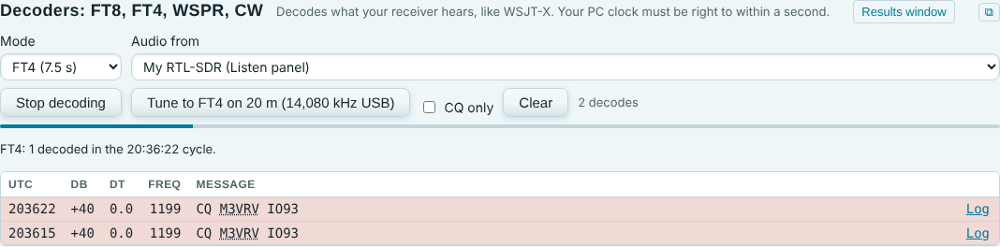
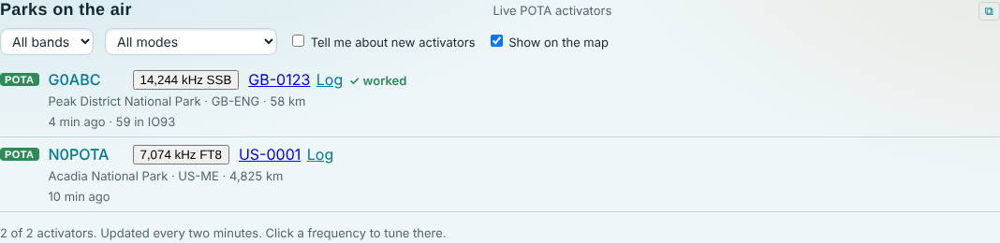
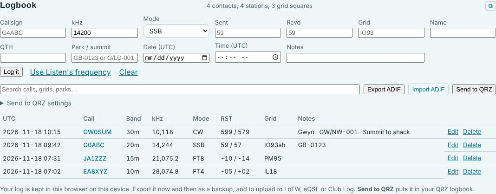
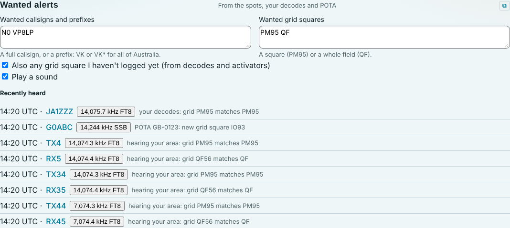
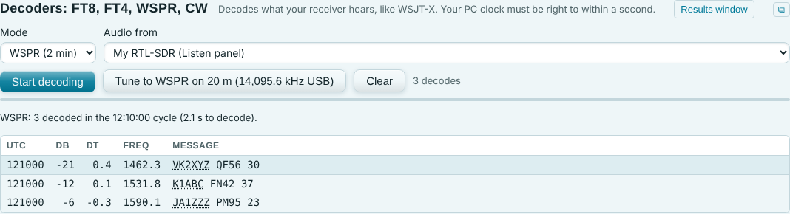
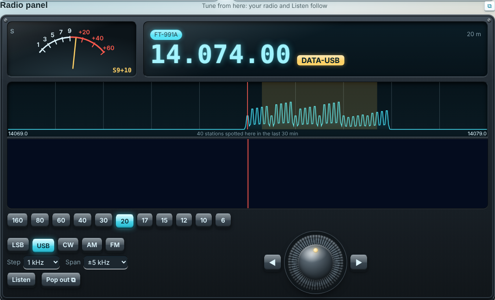
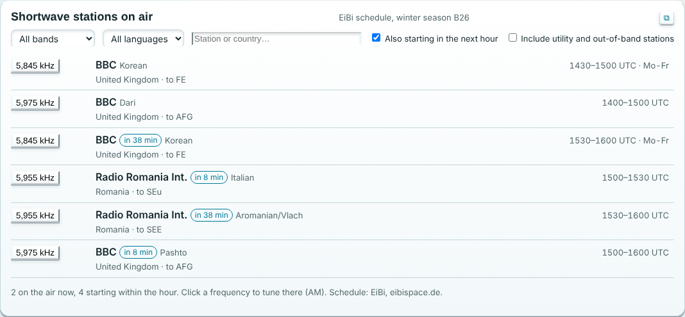
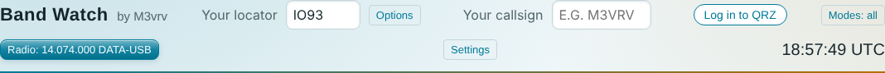

# Band Watch by M3VRV & King Coder

Live HF band conditions for radio amateurs: which bands are open from where you are, from
PSK Reporter spots and NOAA solar data. Free to use, free to share (MIT licence).

- **On a phone, tablet or any browser:** open <https://band-watch.ample.run>
- **On a Windows PC:** download **BandWatch-Setup.exe** from the
  [latest release](https://github.com/TecSpyPie/band-watch/releases/latest), run it, answer Yes. It installs to `C:\BandWatch`
  for you only (no administrator rights) and adds desktop and Start menu shortcuts.
- **Updating:** Settings > Updates > **Install update**, or run a newer BandWatch-Setup.exe: it
  updates your copy in place. No need to uninstall first.

## What it does

- Best band now, a bands table and a map of who hears whom, from live PSK Reporter spots
- Band scope: live spectrum and waterfall from your RTL-SDR, or drawn from spots
- **ClearRX by M3VRV & King Coder** (Windows): a radio audio processor of its own (a separate download, ClearRX-Windows.zip): voice and CW filters,
  auto notch, noise reduction and steady volume for the sound from your radio, a mixer or any sound card. While it's
  open, Band Watch can send its RTL-SDR sound through it
- Listen: public WebSDR/KiwiSDR receivers, or your own RTL-SDR (Blog V4, V3 or others) through rtl_tcp,
  which comes with the Windows app
- **Radio control:** tunes your Yaesu (FT-991A, FT-710, FTDX10, FTDX101), Icom (IC-7300, IC-705, IC-7610,
  IC-9700 and other CI-V radios) or Kenwood (TS-590, TS-890, TS-990, TS-480, TS-2000) over USB when you click
  a spot, the scope or a decoder, and follows the radio's dial (Chrome or Edge on the PC the radio is plugged into)
- **ATS Mini:** the SI4732 pocket receiver (firmware 2.34 or later, Settings > USB Port > Ad hoc) works the same way:
  Band Watch changes its band and mode and tunes it, shows its signal strength and SNR, and has a panel with a
  live picture of the radio's screen and its buttons
- **Malahit DSP2:** tuned over its Malahit CAT USB port (Kenwood TS-480 commands), 10 kHz to 2 GHz
- Decoders for FT8, FT4, WSPR and CW (Morse), with a results window
- **POTA:** live park activators on a list, the map and the scope, with alerts
- **Radio panel:** the front of a transceiver on screen: big frequency display, live S-meter, close-up spectrum and waterfall, band
  and mode keys and a tuning knob; pop it out into its own window; your radio follows
- **Shortwave stations on air:** what's broadcasting right now from the EiBi schedule; click one to tune your radio
- **Logbook:** one-click logging from decodes, activators and lookups; ADIF export for LoTW, eQSL and Club Log, and **Send to QRZ** straight into your QRZ logbook
- **Wanted alerts:** callsigns, prefixes and grid squares you need, and new grid squares not in your log
- UK band plan, sunspots and space weather, world clock, band monitor alerts
- **More than one screen:** put the scope, map, Listen, the ATS Mini panel and other parts in their own windows
- QRZ.com lookups (sign in with your own QRZ account; your password goes only to QRZ.com and is never stored)

## Screenshots

| Live band scope from your RTL-SDR | Listen with your RTL-SDR |
|---|---|
|  |  |

| FT8 / FT4 decoder | Decodes window |
|---|---|
|  |  |

| Parks on the air (POTA) | Logbook |
|---|---|
|  |  |

| Wanted alerts | WSPR decoder |
|---|---|
|  |  |

| The Radio panel |
|---|
|  |

| Shortwave stations on air |
|---|
|  |

| Your FT-991A connected |
|---|
|  |

| RTL-SDR settings | On a phone (dark mode) |
|---|---|
|  |  |

*Screenshots use demo spots, test signals and a pretend radio.*

## Connect your radio

Band Watch tunes your radio over its USB cable (CAT), in Chrome or Edge. Install the maker's USB driver first.

- **Yaesu FT-991A** (FT-710, FTDX10, FTDX101): Silicon Labs CP210x driver. **Settings > Radio control**: Yaesu,
  4800 baud (menu 031 CAT RATE). **Connect radio**, then pick the **Enhanced COM Port**.
- **Icom IC-7300** (IC-705, IC-7610, IC-9700…): CP210x driver from icomjapan.com. On the radio,
  **MENU > SET > Connectors > CI-V**: CI-V USB Port *Unlink from [REMOTE]*, CI-V USB Baud Rate *Auto*,
  CI-V Transceive *ON*. In Band Watch: Icom, model IC-7300, 115200 baud, **Connect radio**, pick the CP210x port.
- **Kenwood** (TS-590, TS-890, TS-990, TS-480, TS-2000): Kenwood's COM port driver; match the radio's baud rate.
- **ATS Mini**: no driver; on the radio **Settings > USB Port > Ad hoc**.
- **Malahit DSP2**: pick its **Malahit CAT** port (Windows may need the driver from malahiteam.com).
- **RTL-SDR** (Blog V4 and others): set its driver once with [Zadig](https://zadig.akeo.ie) (Options > List All
  Devices, *Bulk-In, Interface (Interface 0)*, WinUSB, Replace Driver), then **Listen > Receiver > My RTL-SDR**.

## Windows warnings

Until the Windows files are code-signed (see [CODE_SIGNING.md](CODE_SIGNING.md)), Windows may say
"Windows protected your PC": click **More info**, then **Run anyway**. If Smart App Control is on,
Windows blocks unsigned programs outright: use `install.bat` from **BandWatch-Windows.zip** instead,
which runs Band Watch with Node.js. See [windows/README-Windows.txt](windows/README-Windows.txt).

## Run from source

    npm start            # serves on $PORT (default 8080)
    npm test             # server, API, radio and FT8 tests (no network needed)
    npm run test:browser # end-to-end tests in headless Chrome (needs Playwright)
    npm run test:go      # the Go server's tests and the same suites against it

## Build the Windows files

    sh desktop/build.sh          # desktop/build/BandWatch.exe (needs Go and llvm-rc / llvm-cvtres)
    sh desktop/build-setup.sh    # desktop/build/BandWatch-Setup-<version>.exe
    sh tools/package-windows.sh  # dist/BandWatch-Windows.zip and the setup exe

Raising the version in `package.json` and pushing to main builds, tests and publishes GitHub release
`v<version>` with these files (`.github/workflows/release.yml`).

`sh desktop/build.sh` writes `build-info.json` (version and UTC build time). The date goes into
both exes, `/healthz` reports it under `build`, and Settings > About this build shows it. Set
`BW_BUILD_DATE` for a reproducible date.

## Layout

    server.js, qrz.js    Node.js server: page, /api/solar, /api/sun, /api/spots, /api/qrz/*, RTL-SDR bridge
    desktop/             the same server in Go: BandWatch.exe; desktop/setup is BandWatch-Setup.exe
    public/              the page (HTML, CSS, js/)
    windows/             install.bat, start/stop/uninstall scripts and README-Windows.txt
    test/                node:test suites

## About SOTA

Band Watch doesn't show SOTA spots. SOTA's API terms say software written with AI may not connect to the SOTA
API without their approval, and Band Watch is written with Claude. You can still log summit contacts and
export them with their SOTA reference in ADIF.

## Support

Band Watch and ClearRX are free and open source, and always will be.
<!-- SUPPORT_URL: the owner can add a line here, e.g. "If you'd like to say thanks: https://ko-fi.com/yourname" (also set SUPPORT_URL in public/js/support.js) -->

## Licence

MIT, see [LICENSE](LICENSE). Data: spots from [PSK Reporter](https://pskreporter.info), park activators from [POTA](https://pota.app), shortwave schedules from [EiBi](http://www.eibispace.de/) (Eike Bierwirth), solar and
space weather from [NOAA SWPC](https://www.swpc.noaa.gov), satellite orbits from [CelesTrak](https://celestrak.org)
(worked out with [satellite.js](https://github.com/shashwatak/satellite-js), MIT), world map outline from [Natural Earth](https://www.naturalearthdata.com/) (110m land, public domain).

Want to help? See [CONTRIBUTING.md](CONTRIBUTING.md): ideas as Issues, code as pull requests. Please keep refresh rates modest:
PSK Reporter is run by a volunteer.
